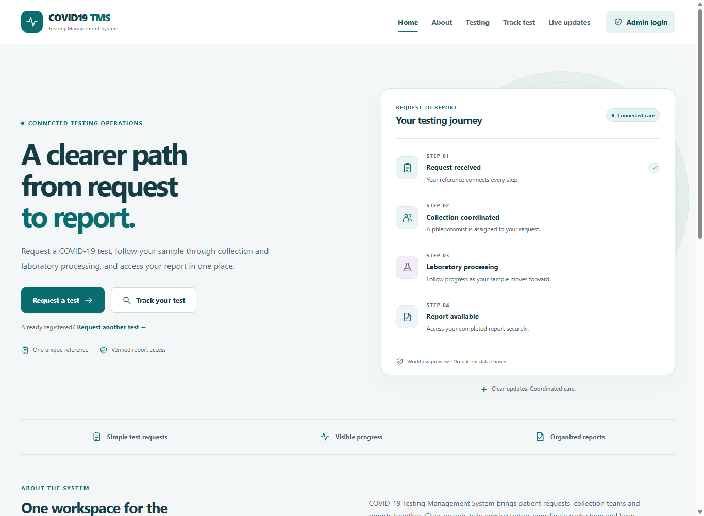
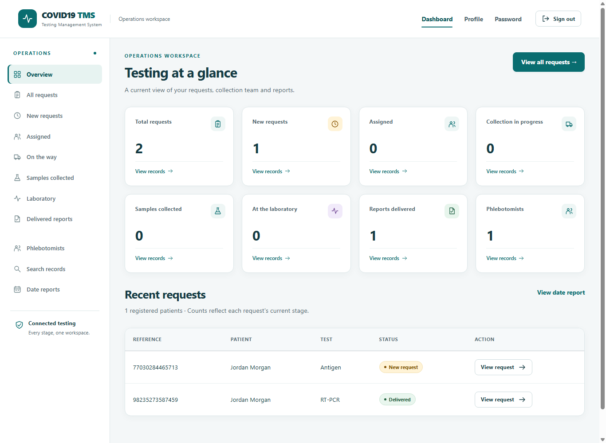

# COVID19-VMS

A PHP and MySQL application for coordinating COVID-19 test requests, sample collection, laboratory results and report delivery. Originally named **COVID-19 Vaccine Management System**, the existing application implements a **testing-management workflow**. This modernization keeps its core stack, five database tables and public page URLs.

## Screenshots

Screenshots use synthetic demonstration records.





[Mobile landing page](docs/screenshots/landing-mobile.png) · [Patient request form](docs/screenshots/request-desktop.png) · [Mobile dashboard](docs/screenshots/dashboard-mobile.png)

## Features

**Patients:** submit a first test request; request another test using registered mobile and birth date; receive a unique reference; verify reference/mobile/birth date to track progress; view a delivered result and download its PDF. Live updates display aggregate counts without patient details.

**Administrators:** sign in securely; review database-driven statistics; search and paginate requests; filter status/date ranges; create, edit and manage phlebotomists; assign requests; record collection and laboratory progress; save or correct results/PDFs; deliver reports; update profile/password; print request details.

Staff may be deleted only when they have no associated tests. Patient and test deletion is intentionally unavailable to preserve report history.

```text
New → Assigned → On the Way for Collection → Sample Collected → Sent to Lab → Delivered
```

At the laboratory stage, save a structured result and PDF before marking delivery. Report corrections preserve status and append history.

## Technology

PHP 8.1+, MySQL 8 / MariaDB 10.4+, HTML5, custom CSS, JavaScript, bundled Bootstrap 4 and jQuery. PHP extensions: mysqli with mysqlnd, mbstring and fileinfo. XAMPP provides Apache, PHP, MariaDB and phpMyAdmin.

No framework conversion, CDN, npm installation or asset build is required to run the application. Node.js 22+ is used only by the optional integration test runner.

## Project layout

The application now lives directly in the repository root. The Apache folder name determines the URL prefix; all existing PHP route names remain unchanged.

```text
*.php                       # application routes
includes/                   # configuration, controllers and shared layout
css/  js/  img/  vendor/     # local assets
database/covidtmsdb.sql      # schema only, no accounts or patient data
docs/                       # documentation and synthetic screenshots
reportfiles/  storage/      # protected runtime directories; data ignored
tools/                      # admin CLI, migration and development router
  tests/                    # workflow, regression, browser and isolated runner
```

## XAMPP installation

1. Clone or download this repository.
2. For a fresh installation, place the repository contents directly in `C:\xampp\htdocs\covid-tms`. If that folder already exists, preserve it and use `C:\xampp\htdocs\covid-tms-modern` for a preview at `http://localhost/covid-tms-modern/`. Do not overwrite the working application or import into its database.
3. Start **Apache** and **MySQL** in XAMPP Control Panel.
4. Open phpMyAdmin at `http://localhost/phpmyadmin`. Import **database/covidtmsdb.sql** into a new installation. The file creates and selects **covidtmsdb**. Do not import it over an existing database.
5. Copy `includes/config.example.php` to `includes/config.local.php`, then adjust connection settings. The defaults use local host, database `covidtmsdb`, XAMPP's local root account and an empty local password. Production credentials belong only in the ignored local file or environment variables.
6. Open a private PowerShell terminal in `C:\xampp\htdocs\covid-tms` and create an administrator:

   ```powershell
   & C:\xampp\php\php.exe tools/admin.php create
   ```

   Enter your own username, password (12–72 bytes), display name, email and 10–15 digit mobile number at the prompts. Password input is visible in this simple local CLI tool; it is never passed as a command argument. No shared/default account is supplied.
7. Open **http://localhost/covid-tms/**. Admin access is at **http://localhost/covid-tms/login.php**.

The web server must be able to write PHP sessions, upload temporary files and the configured report storage directory. Set `APP_TIMEZONE` to the timezone in which patients choose collection slots; default is UTC. Preferred slots must be in the next 90 days.

### Configuration

Environment variables override `config.local.php`: `APP_ENV`, `APP_TIMEZONE`, `DB_HOST`, `DB_PORT`, `DB_NAME`, `DB_USER`, `DB_PASSWORD`, `REPORT_STORAGE`, `ALLOW_LEGACY_MD5`.

Use `APP_ENV=development` for local debugging. Default production mode logs technical errors and presents a helpful service message. Logs go to PHP's configured error log. Keep local configuration, logs, database backups and uploaded reports out of Git.

For deployment, set `REPORT_STORAGE` to a directory **outside the document root**, use HTTPS and a dedicated database account, and serve the application root. Apache must honor the supplied `.htaccess` files; other servers require equivalent denial rules for `includes`, `tools`, `storage`, `reportfiles`, `database` and `docs`.

### Optional PHP development server

With MySQL running, open a terminal in the application directory:

```powershell
& C:\xampp\php\php.exe -S 127.0.0.1:8080 -t . tools/dev-router.php
```

Then visit `http://127.0.0.1:8080/`. Use the router: PHP's built-in server does not enforce Apache `.htaccess` files.

## Existing database migration

Keep your existing data rather than importing the empty installer.

1. Back up the database and old `reportfiles` PDFs. Work on a copy first and stop web writes during migration.
2. Configure the application to use that database.
3. Run the audit-only command:

   ```powershell
   & C:\xampp\php\php.exe tools/migrate.php
   ```

4. Resolve reported duplicates, missing related records, invalid statuses/phones or incomplete records manually. The tool does not guess which records to delete or merge. Numeric phone values from old schemas cannot recover lost leading zeros.
5. After a successful audit and backup, apply:

   ```powershell
   & C:\xampp\php\php.exe tools/migrate.php --apply
   ```

The migration retains table names and record IDs; normalizes new-request status; converts encoding to utf8mb4 and phones to strings; expands password storage; adds `TestResult`, unique indexes and foreign keys; and copies valid legacy PDFs into protected storage. It reports missing/invalid legacy files. Historical date strings and assignment-name snapshots are retained. Existing delivered reports with no structured result display “See PDF report.”

MySQL DDL is not transactional. A failure may leave a partial schema change; rerun after resolving the error or restore your backup. Reruns were verified against both original dumps and the clean schema.

Legacy **MD5** accounts upgrade to `password_hash()` on successful sign-in. Plaintext hashes are not accepted. Reset an unknown or plaintext legacy password using:

```powershell
& C:\xampp\php\php.exe tools/admin.php reset
```

After all legacy accounts have been upgraded/reset, set `ALLOW_LEGACY_MD5` to false. The former public mobile-number password reset now directs users to their system administrator.

## Database

Five original tables remain: `tbladmin`, `tblpatients`, `tblphlebotomist`, `tbltestrecord`, `tblreporttracking`. The canonical installation contains no historical records or PDF fixtures.

Tests retain the original mobile-number relationship to patients and employee-ID relationship to collection staff. Tracking records reference the unique order number. Foreign keys preserve these relationships; indexes support status/date filters. Patient/test creation and status/history writes use transactions. New order numbers contain 14 random digits and are unique in the database.

## Security improvements

- Prepared statements for all user-provided query values.
- Server-side length, phone, birth-date, time-slot, result and workflow validation.
- Escaped output; local assets and a restrictive Content Security Policy.
- Password hashing/verification, legacy MD5-on-login migration, password length limits.
- Session regeneration after sign-in/password changes, HttpOnly/SameSite cookies, HTTPS Secure cookies and 30-minute admin inactivity timeout.
- CSRF protection on state-changing forms and POST-only deletion/logout.
- Patient record access requires reference, mobile and birth date; grants expire after 30 minutes.
- PDF extension, MIME, signature, upload-error and 5 MB checks; random storage names; authorized attachment downloads.
- Atomic writes, database constraints and friendly logged error handling.
- No default credentials, committed local secrets, historical patient dumps or uploaded PDFs.

Login/tracking attempt limits are session-based. This is a student portfolio application: production identity verification and abuse protection would benefit from verified patient accounts/OTP and shared rate limiting.

## Verification

Verified on PHP 8.1.25 and MariaDB 10.4.32:

- 50 HTTP/database integration checks passed through both PHP's development server and XAMPP Apache, covering requests through report delivery/correction, identity verification, admin CRUD, authentication, CSRF, validation, upload rejection, output escaping, protected downloads, search and date reports.
- Both original SQL dumps migrated successfully in isolated copies; migrations also reran successfully.
- Desktop (1440px) and mobile (390px) layouts checked in headless Chrome, including local asset loading and horizontal overflow.
- PHP syntax checks and rendered navigation checks.
- Additional checks covered MD5-on-login upgrades, session cookie flags/regeneration, 28 public/admin routes, pagination, GET-delete rejection and database-outage responses.

Run all retained automated tests from the repository root:

```powershell
node tools/tests/run.mjs
```

The Windows runner uses XAMPP binaries and Chrome. It initializes a new disposable MariaDB data directory and starts isolated services on ports 33316, 8086 and 9226, refusing occupied ports. It never connects to the working database on port 3306. It imports only the clean schema, generates synthetic fixtures, runs PHP lint, workflow/regression/browser checks and migration audit/reruns, then stops its own child processes. Generated data, credentials, logs, sessions and screenshots stay in ignored `.test-artifacts/`.

Override `PHP_BIN`, `MYSQL_BIN`, `MYSQLD_BIN`, `MYSQL_INSTALL_DB_BIN` or `CHROME_BIN` for other installation paths. Node.js 22+ is required. The standalone workflow runner also refuses port 3306 and databases that already contain tables. Historical private dumps and one-off UI snapshots are excluded from publication.

## Troubleshooting

- **Service unavailable:** start MySQL; verify host/port/credentials; import the schema or migrate the existing database; inspect PHP's error log.
- **Session/form expired:** refresh the form; confirm PHP can write `session.save_path`; sign in again after inactivity.
- **Report upload rejected:** upload a real PDF no larger than 5 MB; PHP's `upload_max_filesize` and `post_max_size` must allow that size plus form overhead.
- **Delivered report missing:** inspect the migration's file messages and provide the original PDF or a corrected report.
- **Assets or links fail:** serve the `covid-tms` directory via Apache/PHP rather than opening files directly.

## Future improvements

Verified patient accounts/OTP, server-wide abuse limits, collection-slot capacity and scheduling, email notifications, staff deactivation/reassignment, encrypted sensitive identifiers, and richer operational analytics.

## GitHub preparation

The repository includes setup documentation, screenshots and ignore rules. Local originals are retained in ignored `.local-backup` for recovery. Review your staged files before publishing; retain the empty SQL installer and synthetic screenshots, and exclude real patient data and deployment credentials. GitHub Pages cannot execute this PHP/MySQL application; use PHP-capable hosting for a live demo.
